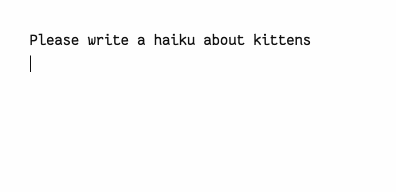

# Simple Note Chat

Use a keyword to chat with LLMs in a note; designed to work great on mobile and desktop. This is a comfortable way to chat without needing keyboard shortcuts or buttons.

The keyword is `cc` in this example (it can be changed):



Connect OpenRouter with your own API key, a ChatGPT subscription on desktop, or both. Choose the connection for each request by selecting its model.

Conversations have separators added so that messages from the user and the AI are clearly differentiated. This helps LLMs track conversations better, and enables caching which saves money and improves response speeds.

This plugin enables Obsidian to act as a lightweight chat interface for most any LLM. It's a nice replacement for self-hosted web interfaces, which can be clunky, and a replacement for vendor-specific interfaces which only work with their specific LLMs.

## Features

* The follow keywords are available (and can all be modified):
	* `cc` - chat with an LLM
	* `cm` - change the model you are actively chatting with
	* `gg` - archive the note, moving it to a custom folder
	* `nn` - create a new chat note
* You can mask content to prevent it from being included in the chat
	* `^^^` - anything above this will be ignored
* Responses are streamed
* Generate images with OpenRouter image models and save them as embedded vault attachments
* Optionally include linked notes as context, with a configurable depth or unlimited traversal
* Press `Escape` to quickly stop a stream
* Nearly everything is configurable

## Connections

**OpenRouter:** Add your API key in **Settings → Simple Note Chat → Connections**. This works on desktop and mobile, with usage billed by OpenRouter. Existing keys and selected models continue to work.

**ChatGPT subscription (desktop):**

1. Enable **ChatGPT subscription** in **Settings → Simple Note Chat → Connections**.
2. Click **Continue with ChatGPT** and approve sign-in and token sharing in your browser.
3. Select a model from **ChatGPT subscription · Using ChatGPT plan** in the chat model dropdown or the `cm` picker. You can also select a subscription model for note titles.

This connection uses OpenAI's official [Sign in with ChatGPT](https://developers.openai.com/siwc/token-sharing-open-source/sign-in) flow for local open-source apps. Requests go directly to the [Responses API](https://developers.openai.com/siwc/token-sharing-open-source/models-and-inference) using your ChatGPT plan allowance. No Codex installation, API key, or separate app registration is needed. Available models and sharing limits depend on your account. Use **Manage usage** in settings to review your allowance at [ChatGPT usage settings](https://chatgpt.com/settings/usage).

Subscription models appear in their own section above OpenRouter, in the order OpenAI returns them. Your sorting preference applies to OpenRouter. The same model offered through both connections has separate entries. Failed requests never automatically switch providers or billing accounts; if one connection fails while loading models, the other connection's models remain available.

Sign-in uses a temporary callback listener bound to `127.0.0.1`, PKCE, and verified OpenAI identity tokens. Credentials are stored in `~/.simple-note-chat/chatgpt.json`, outside the vault, with owner-only permissions on Unix and atomic updates. This file contains sensitive tokens; do not share or sync it. Sign in separately on each computer. **Sign out** removes local credentials and attempts to revoke the renewable session with OpenAI. Disabling the connection stops active requests while preserving sign-in. OpenRouter remains available on mobile.

The conversation selected by the normal chat boundaries is submitted, along with linked note context if **Include linked notes** is enabled. Requests send native user/assistant messages, use `store: false`, and offer no tools or filesystem access. Title reasoning effort and token-limit settings currently apply only to OpenRouter; the direct ChatGPT connection uses model defaults.

**Migrating from the earlier Codex connection:** Sign in again using **Continue with ChatGPT**. Existing `chatgpt/` model selections are preserved, but you may need to select a replacement from the new catalog. The new connection does not read or reuse the old Codex credentials in `~/.simple-note-chat/codex`; signing out here only disconnects the new connection. You can separately remove the old isolated Codex directory if you no longer use it.

## Detailed Examples

### Chatting (`cc`)

Type `cc` on it's own line, then press enter/return to initiate a chat. By default, everything in the note will be processed and sent to the model.

The keywords need to be on their own line to be recognized. So if it occurs inside a sentence it will be ignored.

```markdown
Tell me a haiku about kittens.
cc  <- cc on it's own line, just press enter for it to work
```

```markdown
Tell me a haiku about kittens. cc  <- 'cc' is not on it's own line, so it won't be recognized
```


### Generating images

Select an OpenRouter model labeled **Image output** with `cm` or in settings, describe your image, then use `cc` as usual. The plugin supports both text-and-image chat models and image-only models. Image requests wait for the complete result; ordinary text models continue streaming.

Generated images are saved using Obsidian's attachment-folder setting for the current note, then embedded in the assistant response. Multiple images and accompanying text are supported. The embeds use vault-relative paths so they also work when a conversation is copied to an archive note. Press `Escape` to cancel a pending request.

This supports image **output**. Existing image embeds are sent as Markdown text, not uploaded as image inputs, so follow-up image editing and models requiring reference images are not supported. Use a text-capable model for automatic note titles.

Image generation is currently unavailable through the ChatGPT subscription connection: OpenAI's [token-sharing preview limitations](https://developers.openai.com/siwc/token-sharing-open-source/preview-limitations) explicitly exclude it. OpenRouter generation uses your OpenRouter API key and billing.

### Limiting what is sent to the AI

You can quickly limit what is sent to the model by adding a boundary marker. This is useful for notes where you have other things going on, and you only want to chat about something specific quickly.

The boundary marker is `^^^`. Put that on it's own line and anything above the marker will be ignored and not sent to the AI.

**Example:**

```markdown
This is a personal journal note that contains information that I don't want to send to the LLM.
All this content will be ignored since it's above the ^^^ marker.

^^^

What do I need to know about adopting a cat?

cc
```

In this example, the LLM will only see the question about adopting a cat, and not the personal notes.

If you archive the chat afterward (using `gg`), then only content up to the boundary will be cleared and saved to your archive. So it's a fast way to ask a question, save the response somewhere else, then move on with your day.

### Including linked notes

Enable **Settings → Simple Note Chat → Linked notes → Include linked notes** to include linked Markdown notes in chat requests. This is **off by default** and works with either connection.

**Linked note depth** defaults to **2**:

- **1:** Include notes linked directly from the current conversation.
- **2:** Also include those notes' linked notes, but nothing beyond that.
- Enable **Unlimited depth**, below the depth field, to include every reachable note. The depth field stays visible but disabled, and its previous value is restored when unlimited is turned off. Each note is included once, so circular links stop safely. Large collections can exceed the model's context limit or increase usage.

Both `[[notename.md]]` and `[description](link.md)` work, as do aliases, heading/block links, and embedded Markdown notes. Obsidian's metadata cache and link resolver handle parsing and finding the destination relative to each source note. External URLs, unresolved links, and non-Markdown attachments are skipped. Heading and block links include the entire destination note.

Only links after the last `^^^` boundary and before the chat initiation point in the **current note** are followed. **Linked notes are included in full**, including text and links above any `^^^` markers they contain. A link back to the current note never adds its excluded content. Linked context is labeled with vault paths in the request; it is not inserted into your note or included in archive title generation.

The plugin waits briefly for Obsidian to index the current note so newly typed links are included. If indexing does not finish, the request stops with a retry message. Missing or unreadable linked-note metadata/content produces a notice when context cannot be fully loaded.

### Reading While a Response Streams

You can scroll through the note and select text while a response is being generated. Incoming text and the end of the response leave your navigation under your control, without jumping back to the cursor or the bottom of the note.

### Stopping a Response

If the LLM response is not useful or going off track, you can stop it mid-stream by pressing the `Escape` key.

### Changing the Model

Typing `cm` on its own line opens a searchable model picker. Click a model to use it, or toggle the star on its left to add or remove it from Favorites without changing the active model. Favorites are saved across restarts and appear in their own section at the top of the picker and settings dropdowns. Your model sorting preference is preserved within each section.

### Finished with a Chat (`gg`)

To archive a note, type `gg` on it's own line then press enter.

This phrase marks a chat as completed and optionally assigns a title, moving the note to an archive directory of your choice.

For example, the original note might be:
`vault/questions.md`

And then after archiving:
`vault/archive/questions about cats.md`

It's fully configurable, so you can change:
- archive directory
- whether to change the title of the note
- whether to add a date/time prefix, etc.

When title generation is enabled, the title word limit is strictly enforced on the model's response, and two OpenRouter settings control reasoning-capable models (like OpenAI's o-series or gpt-oss): the reasoning effort level (`none` through `max`) and a rough limit on how many tokens the model may spend reasoning before it answers. The defaults (minimal effort, 1000 tokens) work with both reasoning and non-reasoning title models.

Currently, archiving will only work on notes that have had a chat session. Although it seems like it would be helpful to archive any note, so this will probably change to be more permissive (or configurable).

### Creating a New Chat Note (`nn`)

Type `nn` to quickly create a new note for chatting.

This provides a shortcut for adding a note to your chat or archive directory quickly. It has some default note title options as well (such as using today's date and time).

### Message Attribution

This is a technical level of detail FYI, so can be ignored if you don't want to know the details.

Messages are separated using a horizontal line. The plugin automatically adds these and uses them to distinguish between user messages and AI responses.

The current algorithm for message attribution is simple, but seems to work well: the first message is assumed to be from the user, the next from the AI, and so on.

**Example of Separators (Source Mode view):**

```markdown
User's first message.

<hr message-from="chat">

AI's first response.

<hr message-from="chat">

User's second message.

<hr message-from="chat">

AI's second response.
```

The `<hr message-from="chat">` separator is unique enough that it should never show up in a response from an AI, so parsing the conversation is fairly robust. The other markdown horizontal rules (`---`, `___`, or `***`) would work, but they are more likely to be part of an AI response, which the plugin would then parse incorrectly when attributing messages.

When parsing the above conversation, this is what would get submitted to the vendor's API:

```
{
  "messages": [
    {
      "role": "user",
      "content": "User's first message."
    },
    {
      "role": "assistant",
      "content": "AI's first response."
    },
    {
      "role": "user",
      "content": "User's second message."
    },
	...
}
```

### Trivia

Each keyphrase has an inspiration:

- `cc` call chat
- `cm` change model
- `nn` new note
- `gg` good game - and signifies the chat is over. Other phrases considered were `ac` for archive chat, `ta` for thanks and see-you-later, or `aa` for *a-archive*

## Contributing

Contributions are welcome!

Please see the [contributing](https://github.com/aarons/obsidian-simple-chat/blob/main/contributing.md) file for development setup and other guidelines.

In short:

* Open a Pull Request (PR) with a clear explanation of the changes.
* Contributions that add third-party dependencies are unlikely to be accepted.

## License

This project is licensed under the **Affero General Public License (AGPL) v3.0**

More details are here: [LICENSE](https://github.com/aarons/obsidian-simple-chat/blob/main/LICENSE)
